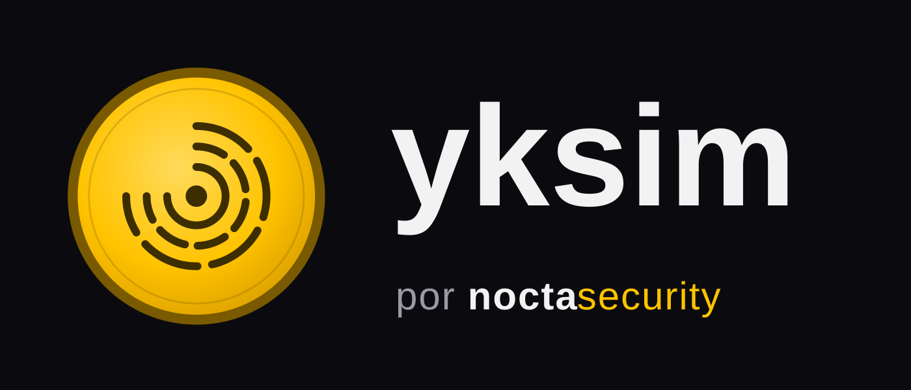
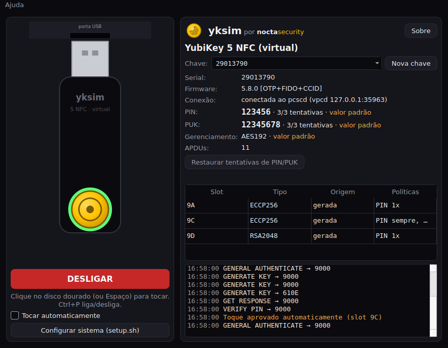
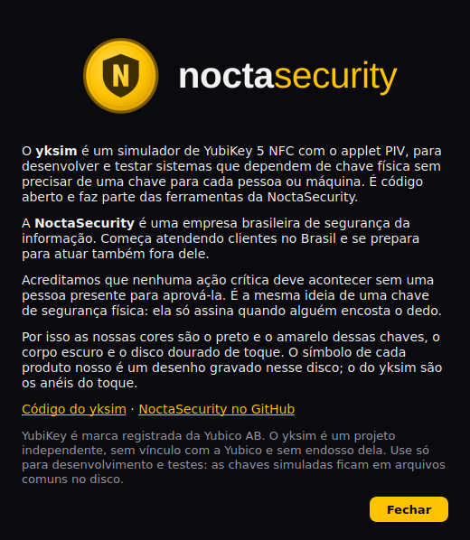

<p align="center"></p>

# yksim: simulador de YubiKey 5 NFC

O yksim é uma YubiKey 5 NFC (firmware 5.8.0) virtual, com o applet **PIV**, exposta ao sistema como um leitor
PC/SC de verdade através do `vpcd` (vsmartcard). Programas que falam com uma YubiKey, como o `ykman`, o OpenSC
ou a sua própria aplicação, enxergam a chave virtual como se ela estivesse espetada na porta USB.

Serve para desenvolver e testar sistemas que dependem de YubiKey sem precisar de uma chave física para cada
pessoa ou para cada máquina de CI: gerar chaves nos slots, verificar PIN e PUK, bloquear PIN, assinar desafios
e simular o **toque** no disco dourado.



## O que ele faz

- **PIV**: slots 9A, 9C, 9D e 9E; chaves ECCP256, ECCP384 e RSA; políticas de PIN e de toque; PIN, PUK e
  chave de gerenciamento com valores padrão de fábrica.
- **Toque**: aprovação automática, recusa, ou espera pelo clique no disco dourado (ou Espaço).
- **Várias chaves**: cada chave tem um serial de 8 dígitos e o seu próprio estado, guardado em
  `~/.local/share/yksim/` (um `<serial>.json` por chave, com permissão 0600).
- **Interfaces**: janela nativa (Qt), interface no navegador, janela Tk e modo só terminal.
- **Registro de APDUs**: cada comando recebido e a resposta, ao vivo.
- **Sobre** (botão no topo ou F1): o que é o yksim e quem é a NoctaSecurity, nas interfaces Qt e web.

## Instalação (Debian 13 ou Ubuntu no WSL2)

```sh
./setup.sh
```

O script instala o `pcscd` e o `vsmartcard-vpcd`, renomeia o leitor virtual para que o `ykman` o reconheça,
cria o ambiente Python em `.venv` e coloca o comando `yubikey` em `~/.local/bin`. Ele usa `sudo` e precisa do
systemd ativo.

## Uso

```sh
yubikey              # abre a janela e libera o terminal
yubikey --web        # interface no navegador (http://localhost:8765)
yubikey --terminal   # sem interface
yubikey --serial N   # abre a chave N (cria se não existir)
yubikey --stop       # fecha o simulador

.venv/bin/ykman list # confere que a chave virtual aparece
```

O manual completo, com a arquitetura, tutoriais, o app cliente de teste e a solução de problemas, está em
[`docs/MANUAL.md`](docs/MANUAL.md) e, para imprimir ou ler offline, em [`docs/yksim-manual.pdf`](docs/yksim-manual.pdf)
(refaça com `python3 docs/gerar_pdf.py`).

## Testes

```sh
.venv/bin/python -m pytest tests
```

## Identidade visual

As interfaces usam a paleta da NoctaSecurity, o preto e o amarelo das chaves de segurança físicas. A paleta, os
símbolos e o texto do "Sobre" ficam num lugar só, [`yksim/brand.py`](yksim/brand.py) e
[`yksim/assets/`](yksim/assets): a janela Qt e a página web leem dali. O símbolo do yksim são os anéis do toque
gravados no disco dourado.



## Aviso

O yksim é um projeto independente da [NoctaSecurity](https://github.com/noctasecurity). Não tem nenhum vínculo
com a Yubico nem é endossado por ela. YubiKey é marca registrada da Yubico AB.

**Use só para desenvolvimento e testes.** As chaves do simulador ficam em arquivos comuns no disco e a CA de
atestação é de teste: nada disso tem a proteção de hardware de uma YubiKey de verdade.
